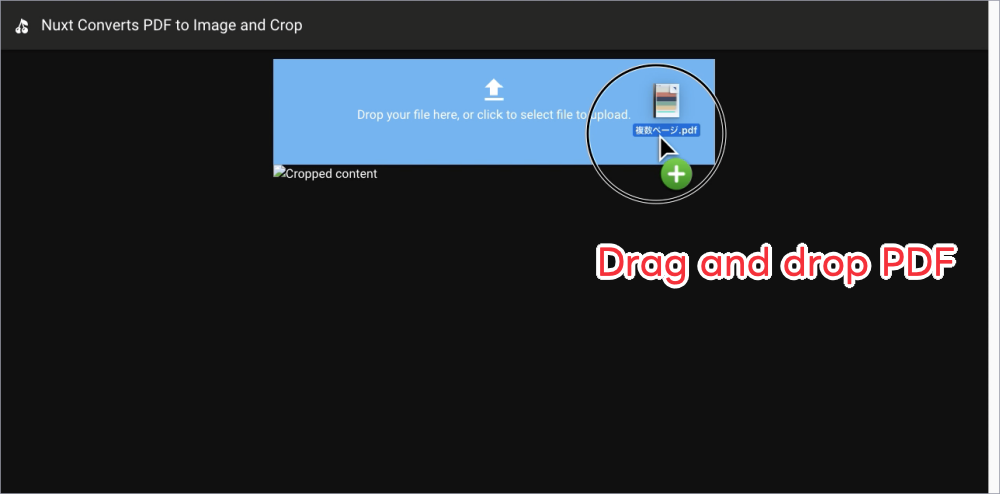
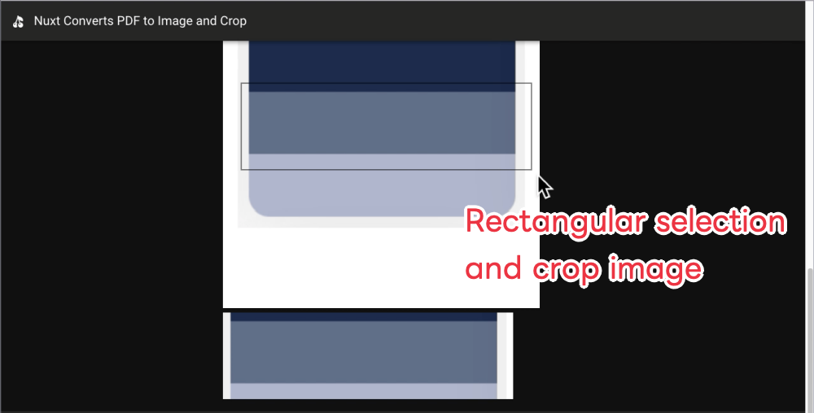

# nuxt-2-converts-pdf-to-image-and-crop

✌🏽✌🏽 📜 Nuxt 2 + Vuetify 2 + pdfjs + crop image using canvas

- Docker: 対応!
- Node.js: 22!
- Linter: ESLint 8 (@nuxtjs/eslint-config)!
- Test: Jest 29 (+ @vue/test-utils 1)!
- Nuxt: 2.17 / Vue: 2.7 / Vuetify: 2.7 / pdfjs-dist: 2.5.207

## パッと実行してみたい

```bash
docker compose up --build
# http://localhost:3000 を開いて PDF をドラッグ&ドロップ
# → 全ページが縦に連結された 1 枚の画像として表示され、矩形選択した範囲が切り抜かれて下に表示される
```

lint とテストも Docker で回せる。

```bash
docker compose run --rm app yarn lint
docker compose run --rm app yarn test
```

PDF の読み込みでは `isEvalSupported: false` を指定して、 pdfjs-dist 2.x のフォント経由の任意 JS 実行 (CVE-2024-4367) を塞いでいる。





```bash
yarn dev
```
